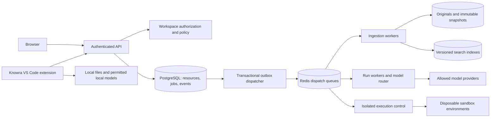

**Knowra — production implementation plan**

Prepared: 15 November 2026. Status: proposed implementation roadmap, not completed work. Phases 9–22 continue the repository's historical phases 1–8. Earlier phase completion does not imply that the current deployment passes the gates below.

**Purpose and release boundaries**

Build a reliable application for repository work, grounded chat, model orchestration, controlled code execution, and VS Code integration. Preserve existing user data and existing integrations. The first release should serve a small private team; anonymous public signup and execution require the later production gates.

The roadmap assumes one deployment region, a modest initial user population, Windows local development, Linux hosting, PostgreSQL as the authoritative application database, Redis for work dispatch, Qdrant for derived vector indexes, and persistent artifact storage. These are planning assumptions, not measured capacity claims. Phase 9 establishes the actual hardware, workload, support ownership, and deployment budget. An Oracle-hosted VM remains an option; no provider, free-tier availability, or spending commitment is assumed.

Three milestones:

| Milestone | Required scope | Meaning |
|---|---|---|
| M1 — reliable local application | Phases 9–14; manual-provider conversation work from Phase 16 | Checkout, browsing, editing, saved chat, and explicitly configured providers work; unavailable features are accurately disabled. |
| M2 — private team beta | Phases 9–20 with Phase 21 isolation and smoke gates | Invited users, separated workspaces, automatic model routing, reviewed code changes, controlled execution, VS Code integration, backups, and monitoring. |
| M3 — public production release | Phase 21 fully passed; Phase 22 operational ownership active | Proven deployment/restore procedures, isolation, abuse controls, tested capacity, published support limits, and monitored service objectives. |

Do not open public registration merely because login works. Do not advertise automatic model switching until the fallback tests pass. A feature can ship disabled if its release gate is incomplete, but the product must describe that accurately.

**Non-negotiable product behavior**

- No LLM model is downloaded automatically. This also applies to embedding weights, rerankers, OCR models, and tokenizers that fetch external artifacts. Use preinstalled, explicitly provisioned, or remote services; disable unavailable optional processing with a clear explanation.
- Starting Knowra, signing in, checking out a repository, browsing/editing files, and basic lexical search must work without an LLM provider.
- Indexing must not control whether files are visible. A parser or embedding failure must not destroy a checkout or the previous usable index.
- Local-only code must not silently move to a cloud model during fallback. Workspace policy determines permitted destinations before any content is sent.
- Reviewed changes must actually apply to the intended workspace, with a base revision, conflict checks, and recovery. Review, apply, commit, and push are distinct actions.
- Existing user modifications, uploaded originals, credentials, database contents, and volumes must survive migration. Cleanup must have explicit retention and ownership rules.
- No long-running job can remain indefinitely in a processing state without a heartbeat, deadline, or documented external wait.

**Baseline evidence from the audit**

| Observation | Evidence and consequence |
|---|---|
| Ingestion worker stopped | Exit 139; a separate parser diagnostic reproduced a segmentation fault through `parser.py` → `_reference_target` → `_node_text`. The underlying native dependency cause remains to be isolated. |
| Checkout exists | Recon had 29 tracked paths and zero missing tracked paths. Its recorded state was `parsing`; UI readiness gating concealed the files. This check does not prove LFS objects/submodule contents or all Git history were fetched. |
| Embeddings unavailable | Configured Ollama endpoint was unreachable. LM Studio model listing returned HTTP 200; model listing alone does not prove generation. |
| Runtime features mismatch packaging | Core image lacks Docling and FastEmbed; reranking is enabled; sandbox execution is disabled. |
| Security incomplete | Default signing secret remains active; all accounts use the fixed local workspace; resource routes lack complete membership enforcement. |
| Code workflow incomplete | Monaco is read-only; patch approval reports the repository unchanged; provider selection is manual. |
| Test baseline incomplete | Four frontend unit tests passed. Backend test collection failed in the existing local environment because `cryptography` was missing. This is an environment failure, not a functional test result. |
| Documentation stale | README still says authentication is absent and mentions waiting for model downloads. Correct it to match implemented and verified behavior. |

**Target architecture and responsibility boundaries**

Keep the existing modular application initially. Separate responsibilities and execution privileges before introducing more services. Avoid a full rewrite or a mandatory Kubernetes deployment.

PostgreSQL owns job state and resource identity. Redis delivers work and supports coordination; Redis loss must not erase the durable work record. Qdrant is a replaceable search index. Artifact storage contains immutable inputs and versions; mutable workspaces need an explicit owner and filesystem service, not concurrent unmanaged writes from every API replica.

For VS Code local workspaces, local files are authoritative and any uploaded index snapshot is a versioned mirror. For browser-managed workspaces, the server workspace service is authoritative. Do not allow both sides to write the same conceptual workspace without revision checks and an explicit synchronization protocol.

**Phase sequence and dependencies**

| Phase | Outcome | Prerequisites |
|---|---|---|
| 9 | Reproducible baseline and honest diagnostics | None |
| 10 | Identity, workspace isolation, and secret migration | 9 |
| 11 | Durable jobs and reliable repository ingestion | 9, 10 |
| 12 | Editable workspace and complete Git workflows | 10, 11 |
| 13 | Reliable provider integrations and model registry | 9, 10 |
| 14 | Usable document/code retrieval with optional embeddings | 11, 13 |
| 15 | Automatic model selection and fallback | 13, 14; conversation contract from 16 |
| 16 | Durable conversations and coherent product UX | 10, 13; integrate 14/15 as available |
| 17 | Controlled project execution | 10, 11, 12 |
| 18 | Coding agent that validates and applies changes | 12, 14, 15, 16, 17 |
| 19 | VS Code integration and local-provider connector | 12, 13, 16; use 17/18 for execution/agent actions |
| 20 | Deployment, monitoring, backup, and recovery | Foundations in 9; final integration after 10–19 |
| 21 | Production qualification and staged rollout | All enabled features and Phase 20 |
| 22 | Operational improvement after release | 21 |

Phase 15 and Phase 16 share a conversation/run contract; define that contract first in Phase 13. Phase 16 manual-provider persistence can finish before Phase 15 routing. CI, authorization tests, telemetry, and documentation are implemented in each phase; Phase 20 is their operational completion, not their first introduction.

**Phase 9 — establish a reproducible and diagnosable baseline**

Goal: stop building on an unknown runtime. Produce one supported development setup and an evidence-backed feature inventory.

Implementation tasks:

1. Inventory tracked/untracked changes and record current commit, dependency locks, image identifiers, migration revision, enabled features, service versions, and volume ownership. Preserve the current working tree. Record sanitized configuration; never copy provider keys into reports.
2. Back up PostgreSQL, original uploads, repository metadata, and non-reconstructible workspace edits before data migrations. Verify that a sample can be restored into an isolated environment.
3. Rebuild the existing Python test environment from the lockfile with the required test dependency group. Install application dependencies only; do not enable model-bearing ingestion extras by default. Fix the missing `cryptography` environment discrepancy and rerun the suite.
4. Create a feature matrix: implemented, configured, verified, unavailable, and planned. Include chat, embeddings, reranking, document conversion, Git credentials, sandbox, web retrieval, and SQL retrieval.
5. Split `/health/live`, `/health/ready`, and authenticated component diagnostics. Liveness checks the process; readiness checks necessary dependencies for that service. Optional provider failure must degrade that feature rather than take down file browsing. Expose worker health separately.
6. Give errors stable codes, a safe user message, retryability, and correlation IDs. Retain redacted diagnostic details server-side. Replace indefinite spinners with a recoverable state.
7. Add CI for backend tests, frontend tests, type checks, lint, migration smoke tests, and production image builds. Use isolated temporary databases and deterministic fake providers, never production state.
8. Pin and verify the supported Tree-sitter/native dependency combination in Linux containers and Windows development. Start with the existing crash fixture; do not conclude that upgrading a package fixes it without rerunning the reproduction.
9. Update README and startup commands. Separate core startup, optional services, and optional paid provider tests. Document which operation can download packages, images, or model artifacts.

Primary code areas: core configuration, Dockerfiles/Compose, parser packaging, health routes, frontend error handling, test setup, README, and new CI workflows.

Exit gate: clean-checkout build and tests are reproducible; failures are catalogued with owners; no startup request downloads model artifacts; worker absence is visible; baseline backups are restorable. The ingestion crash can remain a tracked Phase 11 blocker, but it cannot be described as fixed.

Rollout: diagnostics and configuration checks first. Keep the existing data schema compatible. Disable unavailable features explicitly rather than silently attempting to install their runtime.

**Phase 10 — identity, tenant isolation, and secret lifecycle**

Goal: make every operation answer who is acting, which workspace they belong to, and what they may do.

Implementation tasks:

1. Introduce a request-scoped principal and workspace context. Resolve membership from the database; never authorize a resource solely because a client supplied its workspace ID.
2. Define owner, administrator, member, and viewer roles with explicit abilities for files, providers, executions, approvals, membership, and deletion. Add a unique constraint on workspace/user membership.
3. Enforce resource ownership through shared service/repository methods. Cover repositories, file reads, code search, knowledge bases, chunks, citations, conversations, runs, approvals, execution logs, downloads, vector filters, and background jobs.
4. Decide whether conversations are private or workspace-shared; default to private ownership with deliberate sharing. Distinguish personal providers from workspace providers. A teammate may be allowed to use a workspace key without being allowed to read or replace it.
5. Migrate legacy shared resources to a designated legacy workspace owner using an explicit mapping. Do not copy all historical material into every new account or guess ownership from account creation order.
6. Replace default signing secrets and introduce independent, versioned provider-key encryption. Support read-old/write-new during rotation; re-encrypt and verify stored credentials before retiring the old encryption key. Invalidate old login tokens separately.
7. Use a maintained session/token implementation with short-lived access credentials and revocable sessions. For refresh credentials, store hashes, rotate them, detect reuse, and revoke sessions on logout/password reset.
8. Add login throttling, bounded registration, account recovery, email verification where hosted signup is enabled, and administrator MFA before public production. Use generic authentication failures without leaking whether an account exists.
9. Enforce TLS cookies and CSRF protection for cookie-authenticated mutations. Scope CORS to configured application origins. Keep tokens and provider secrets out of URLs, browser local storage, logs, and traces.
10. Add audit events for authentication changes, role changes, secret replacement, Git publishing, execution authorization, approvals, exports, and deletion. Record actor, workspace, resource, action, and outcome without secret contents.
11. Define provider/network egress policy: hosted deployments deny arbitrary internal/metadata destinations; approved local connectors have a separate scoped policy. Validate resolved destinations and redirect hops, not just URL syntax.
12. Add PostgreSQL row policies where practical as a second boundary. Test with the actual application role, because table owners and privileged roles may bypass row security. Application authorization remains mandatory. [PostgreSQL row-security documentation](https://www.postgresql.org/docs/current/ddl-rowsecurity.html).

Exit gate: two-user/two-workspace tests cannot cross boundaries through any API, event stream, job, search, or artifact identifier. Viewer mutations fail. Revoked membership stops subsequent access and queued sensitive actions. Old credentials migrate without data loss. No default production secret is accepted at startup.

Rollout: add ownership fields and backfill them before enforcing non-null constraints. Run isolation checks on a restored staging copy. Reverting code must not re-enable broad legacy access; use a restricted maintenance mode if an authorization migration fails.

**Phase 11 — durable jobs and repository ingestion**

Implementation update, 17 November 2026: the [repository reliability foundation](phase11.md)
now implements transactional repository jobs/outbox delivery, fenced leases and
bounded recovery, independent processing states, staged initial acquisition,
non-destructive reindex, supervised parser children, optional vector generations,
and workspace UI status/cancel/retry controls. This phase remains in progress;
the linked implementation notes identify unverified deployment gates and remaining work.

Goal: reliably acquire and inspect a repository even when parsing, models, or workers fail.

Implementation tasks:

1. Add durable jobs with type, workspace/resource identity, idempotency key, attempt, lease token, heartbeat, progress, deadline, error code, and cancellation state. Write the job and an outbox event in the same PostgreSQL transaction.
2. Dispatch committed outbox events to Redis. Assume delivery may repeat: workers must claim a lease atomically and reject stale completion writes using the lease token. Reconcile pending jobs after queue loss or dispatcher restart.
3. Introduce independent source, parse, and index states. Source states include queued/fetching/available/failed; parsing and indexing may be unavailable, pending, partial, ready, or failed. Browsing depends on source availability only.
4. Separate import, fetch, checkout, parse, and reindex commands. Reindex the existing immutable snapshot without recloning. Require clean state or explicit resolution before branch replacement. Preserve ZIP source references in typed persistent fields.
5. Clone into a temporary managed location, verify revision and manifest, then publish it as an available snapshot. Preserve the last good checkout if cloning fails. Record commit SHA, selected ref, source type, tracked count, indexable count, and skipped-file reasons.
6. Add branch/tag/commit selection and explicit shallow/full-history controls. Support private HTTPS repositories using encrypted credential references; add SSH only with managed known-host verification and a defined credential lifecycle.
7. Handle submodules and Git LFS deliberately. Validate submodule/LFS destinations independently; parent-repository authorization does not automatically authorize another host. Show unavailable credentials and incomplete assets accurately.
8. Reproduce the current segmentation fault, isolate the responsible native/parser interaction, and pin a validated dependency set. Parse in supervised subprocesses with file-size, memory, and time limits. A native crash becomes a per-file failure, never termination of the main queue worker.
9. Preserve parsing results for successful files; publish partial indexing with warnings. Add lexical/document fallback for unsupported languages and repositories containing configuration or prose instead of supported source symbols.
10. Use a Git-aware file inventory and explicit indexing exclusions. Handle nested ignore rules, Unicode paths, line endings, long paths, large files, and symlinks without letting resolved paths escape the managed root. Browsing exclusions and search exclusions are separate settings.
11. Use content hashes and snapshot IDs for incremental parsing. Write a new index generation, then switch the active generation only after validation. Retain the previous generation until safe cleanup; do not delete good vectors before replacements exist.
12. Add per-repository mutation locks and bounded ingestion concurrency. Recover expired jobs, cap retries, distinguish transient failures from invalid input, and provide cancel/retry/retry-failed-files actions.
13. Set Git network timeouts, disk quotas, and archive extraction limits. Limit decompressed bytes, file count, nested processing, and traversal; keep existing ZIP path protections.

Exit gate: Recon becomes browsable with no model server; parser crashes, queue restarts, duplicate dispatch, network loss, and disk-full faults leave a coherent resource state. ZIP reindex succeeds twice. Existing edits survive reindex. LFS/submodule fixtures report complete or explicitly partial status. A crash cannot leave a job indefinitely active.

Rollout: migrate legacy status into the new state fields; inspect actual worktrees before marking them available. Reconcile stuck historical jobs without automatically deleting/recloning their directories. Keep old index generations during the cutover.

**Phase 12 — editable code workspace and Git lifecycle**

Goal: turn the code screen into a dependable workspace while preserving user work.

Implementation tasks:

1. Create workspace instances backed by a repository snapshot/ref, with an explicit owner and mutation service. Separate source import from an individual's editable working tree.
2. Replace the flat, capped tree with lazy directory expansion, search, pagination, hidden-file controls, and counts that distinguish tracked, present, and indexed files. Display empty files and binary previews/downloads appropriately.
3. Add read/write/create/rename/delete APIs with safe resolved paths, size limits, encoding/newline preservation, and expected-version hashes. Conflicting saves return a conflict response instead of overwriting new content.
4. Add editor tabs, dirty indicators, autosave policy, explicit save, undo/redo, recovery drafts, unsaved-navigation protection, and diff/conflict views. Bound in-browser memory for large files and explain preview limits.
5. Implement Git status including staged, unstaged, and untracked files; branch creation/switching; fetch; pull/merge conflict handling; staging; commit; and push. Keep credentials server-side or in the local extension credential boundary.
6. Make destructive discard/reset, force-push, and branch replacement explicit actions with a reviewable affected-file/ref summary. Do not infer permission for remote publishing from approval of a local patch.
7. Respect supported `.editorconfig` and VS Code formatting settings. Publish the supported subset; do not imply arbitrary extensions/settings work in Monaco.
8. Add file watchers and debounced incremental indexing after changes. Show index revision and staleness; search results must identify the snapshot they refer to.
9. Integrate diagnostics/language services in isolated processes where supported. Terminal, task execution, and debugger launch remain disabled until Phase 17 policies and resource isolation are ready.
10. Keep an auditable filesystem mutation journal. For multi-file edits, validate every precondition, stage writes, and recover from partial interruption; filesystem changes and SQL updates are not one automatic transaction.

Exit gate: edit/save/reopen preserves bytes and line endings; a second editor cannot silently overwrite changes; staged/untracked files appear correctly; branch switching protects dirty work; offline browser recovery works; indexing failure does not prevent editing.

Rollout: enable writes per workspace after backups and conflict handling pass. Provide read-only fallback. Do not expose broad filesystem access outside authorized workspace roots.

**Phase 13 — provider integration and capability registry**

Goal: make LM Studio, Ollama, Google Gemini, and compatible APIs predictable and independently configurable.

Implementation tasks:

1. Define a common adapter contract for discovery, chat, streaming, structured output, tool calls, embeddings, usage reporting, cancellation, and health. Adapters advertise supported capabilities; unsupported methods fail clearly.
2. Replace the plain model-ID list with model records including provider identity, model identifier, capabilities, context/output limits, availability, validation time, and optional administrator-maintained cost metadata. Treat discovery as evidence of existence, not proof of every capability.
3. Normalize URLs by deployment mode. Keep desktop localhost intact for native operation; translate host addresses only when Docker topology requires it. Handle IPv6, invalid ports, path suffixes, redirects, and query strings deliberately.
4. Provide separate checks for network reachability, credentials, model availability, generation, streaming, and embeddings. Make cost-incurring tests explicit and bounded. Discovery can remain read-only; real inference tests require configured credentials and a test budget.
5. Implement a native Gemini adapter when advanced Gemini capabilities are needed; retain compatibility-mode support for existing configurations. Test actual adapter capabilities rather than assuming parity with another provider. Google's documentation supports the compatibility endpoint and recommends direct API use when starting without an existing OpenAI-library dependency. [Google compatibility documentation](https://ai.google.dev/gemini-api/docs/openai).
6. Configure chat, embeddings, and reranking separately. Prevent embedding-only models from appearing as ordinary chat choices. Changing a chat model must not silently change an embedding model/index.
7. Handle empty streaming choices, tool-only deltas, usage-only events, malformed payloads, rate limits, auth failures, context overflow, model unloading, and connection interruptions. Normalize errors and retain provider request IDs without exposing secrets.
8. Reuse bounded HTTP connection pools. Set connect, first-token, idle, and total deadlines separately. Add cancellation, concurrency limits, and provider circuit breakers.
9. Implement safe credential replacement/removal and model retirement. Fail affected requests clearly when a key is revoked; do not reuse another user's key as fallback.
10. Define conversation/run contracts shared with Phases 15–16: versioned messages, routing policy, context budget, run state, per-attempt usage, cancellation, and event sequence numbers.
11. Define an authenticated local-connector interface. A hosted backend's localhost/host gateway is not the user's desktop. Phase 19 supplies a scoped outbound connection for local inference; until then hosted-to-desktop support is explicitly unavailable.

Exit gate: deterministic contract tests pass for every adapter; an opt-in live test confirms each deployed provider's intended capabilities. Invalid key, wrong ID, stopped server, timeout, and interrupted stream are distinguishable. No test downloads models. Secrets remain redacted.

Rollout: backfill existing provider configurations into registry records without discarding IDs or keys. Keep a compatibility adapter available behind a feature flag until equivalent behavior is verified.

**Phase 14 — document, code, SQL, and web retrieval**

Goal: make each advertised knowledge source usable, scoped, versioned, and honest about its limitations.

Implementation tasks:

1. Provide explicit processing modes: lexical-only/no-model; remote embeddings; existing local embedding service; optional preprovisioned OCR/reranking. A mode must declare all dependencies before a job is accepted.
2. Implement lightweight extraction for supported non-scanned formats and plain text/Markdown without mandatory neural artifacts. Scanned PDFs and complex layouts may require an optional conversion service; show that requirement instead of silently downloading it.
3. Build a separate optional conversion image with pinned parsing dependencies. Protect conversion against malformed files, archive bombs, huge tables, pathological page counts, and unbounded processing. Persist original uploads before conversion.
4. Chunk content with provenance: source version, page/section or path/line range, parser version, and content hash. Use deterministic fallback chunking when a model-specific tokenizer is unavailable.
5. Store an immutable embedding profile: provider/model version, dimensions, normalization, distance metric, and chunking version. A query must use the compatible profile for its index. Never fall back to an unrelated embedding model for an existing vector collection.
6. Build new index generations beside existing ones; validate dimension/count/scope checks and switch the active generation atomically at the application metadata layer. Keep the old generation available for rollback and in-flight readers.
7. Add lexical search that has no hidden FastEmbed/model-download dependency. Combine lexical and vector results when both exist; expose source coverage and degraded mode. Optional reranking must preserve usable results when unavailable.
8. Recheck authorization on retrieval, citation opening, previews, and exports. Vector filtering alone is not the sole access boundary. Use tenant/resource/revision-aware cache keys.
9. Replace name-only reference guesses with clearly labeled approximate references; use language-server or richer static-analysis information where supported. Preserve source snapshots so code citations do not silently point to changed lines.
10. Add document/repository deletion as a durable workflow: immediately revoke visibility, then remove object versions, vectors, derived chunks, caches, and orphaned artifacts according to retention policy. Track unfinished cleanup and legal/administrative retention where applicable.
11. Complete SQL source configuration in the UI: separate data-source credentials, schema/table policy, query preview, row limit, timeout, and sensitive-data approval. Retain AST validation and read-only database credentials. Revalidate access/policy when resuming an approved query.
12. Implement web search/fetch only when configured: permitted provider, URL fetch policy, bounded content, cache expiry, source URL and retrieval time. Protect fetches against internal addresses, redirect abuse, and untrusted instructions. Otherwise remove web from automatic route candidates.
13. Build an evaluation corpus covering exact identifiers, cross-file questions, prose, missing answers, conflicting documents, multilingual content, updated/deleted material, and unauthorized data. Evaluate retrieval separately from answer generation.

Exit gate: lexical search and browsing operate with no model service; supported uploads complete or report a precise unavailable capability; citation provenance matches the source version; changing embeddings requires a verified new index; deletion removes retrieval visibility immediately. All enabled SQL/web modes have real integration checks.

Quality gate: establish a versioned evaluation baseline and record recall, citation correctness, unsupported-answer rate, and latency. Set release thresholds from that baseline in Phase 14 rather than inventing claims of model accuracy. Authorization leakage must remain zero in the isolation suite.

Rollout: activate new indexes per workspace; retain previous generations until rollback and retention windows expire. A failed reindex leaves the last good index active and visibly marked as older.

**Phase 15 — omni model selection, switching, and fallback**

Goal: select the right permitted model for a task and recover from provider failures without losing context or duplicating actions.

Implementation tasks:

1. Separate task intent from retrieval sources and execution requirements. A coding task may use code, documents, and web simultaneously; selecting `multi` must not bypass the coding workflow.
2. Support Manual, Auto, Local only, and workspace-defined policies. Manual mode stays on the chosen model unless the user explicitly enables fallback. Local only is an enforced data-transfer rule.
3. Apply hard eligibility filters first: permission, allowed data destination, capability, context capacity, model availability, quota, and budget. Rank remaining candidates by configurable quality preference, latency, cost, and recent reliability. Record the policy version and selection explanation.
4. Allow separate stage models for planning, code generation, review, and final explanation. Use a canonical task/context representation with stage-specific prompts and bounded summaries. Validate model output against the expected schema before advancing.
5. Bound fallback by attempt count, elapsed time, token budget, and spend. Retry transient connection/rate-limit/service errors with jitter and `Retry-After` handling; do not endlessly retry invalid credentials or unsupported requests.
6. Track pre-stream, streaming, tool-pending, and terminal states. Before output, an eligible fallback may start a fresh attempt. After visible output, preserve the partial response and emit an explicit replacement/new-attempt event rather than concatenating unrelated answers silently.
7. Keep tool side effects outside model retry loops. Give actions stable identifiers and durable outcomes. A retried model call must not reapply a patch, rerun a publish operation, or duplicate another non-idempotent action.
8. Add circuit breakers and health cooldowns per provider/model. Reserve budget before dispatch and reconcile actual usage when available. Distinguish estimated costs from provider-reported usage and handle unknown pricing without claiming a precise amount.
9. Never use a cloud fallback for local-only data; never switch from one user's credentials to another's. Recheck policy if permissions or provider configuration change while a run is paused.
10. Display selected model per stage, switches and reasons, attempt history, token usage, latency, and budget exhaustion. Keep an understandable short explanation in the conversation and detailed technical events in the run trace.
11. Use capability-aware context fitting. Account for system instructions, tool schemas, retrieved content, conversation history, and reserved output tokens. Do not trim away user requirements or silently omit all source context.
12. Preserve embedding-profile consistency from Phase 14. Automatic chat switching does not authorize arbitrary embedding switching.

Exit gate scenarios:

- Preferred LM Studio instance is offline: Auto mode uses a permitted alternative; Local only never sends content to Google.
- Provider returns a rate limit: backoff/fallback stays within time and budget constraints and records the decision.
- Selected model cannot handle the required context or tools: the router excludes it before dispatch.
- Stream fails midway: partial output remains labeled and the next attempt is distinguishable.
- Model fails after a tool has completed: recovery does not execute the tool twice.
- No eligible model remains: the user gets an actionable explanation and can still use the workspace.

Rollout: begin with a small explicit rule set and manually curated capability metadata. Enable Auto per workspace after evaluation. Avoid a model-based router dependency until deterministic routing provides a measurable baseline.

**Phase 16 — conversations, streaming, and product consistency**

Goal: make work resumable across page reloads, devices, model changes, and service restarts.

Implementation tasks:

1. Implement conversation CRUD, pagination, ownership/sharing, titles, archive, export, and deletion. Persist user messages before dispatch; record assistant attempts, citations, source revisions, provider/model identity, and run links.
2. Persist run state independently of the HTTP stream. Run workers continue or cancel according to explicit policy when a browser disconnects. An SSE stream subscribes to durable sequenced events; it is not the sole owner of the run.
3. Support event replay with a cursor/last-event ID and idempotent client merging. Persist sufficient output to reconstruct interrupted replies. Bound event retention and checkpoint frequency without storing one database row per token unnecessarily.
4. Add Stop, Retry, Regenerate, and Continue controls with clearly defined semantics. A new attempt has its own identity and cost; retry does not duplicate the preceding user message.
5. Preserve conversation when changing provider/model. Store preferences per user/workspace. A deliberate new conversation should be distinct from a provider dropdown change.
6. Include relevant prior conversation in retrieval queries and grounded generation. Detect source/model changes; use structured summaries when needed and keep originals accessible. Do not silently rely on a summary as the only permanent record.
7. Make provider/model controls consistent while a run is active: disable them or apply changes only to the next run, and state which behavior is used.
8. Show capability-specific onboarding: browse without a model, connect a chat provider, configure embeddings, and enable execution separately. Do not present every failure as a login redirect or generic generation failure.
9. Add accessible keyboard interactions, labels, focus recovery, readable error states, responsive layouts, and safe Markdown/code rendering. Sanitize model-supplied HTML/URLs and retain raw text for export.
10. Add quotas and pagination for long chats and traces. Apply data-retention policies to conversation content, prompts, uploaded attachments, and provider request metadata.

Exit gate: reload during streaming resumes correctly; browser reconnect does not duplicate messages; provider changes preserve history; retrieval follow-up questions use prior context; cancellation stops queued work and best-effort cancels provider work with accurate billing uncertainty; another user cannot replay private events.

Rollout: reuse and migrate existing Conversation/Message tables where suitable. Historical runs without reliable conversation associations remain accessible as runs; do not fabricate conversation histories.

**Phase 17 — secure, reproducible execution environments**

Goal: run checks and project tasks in controlled environments without giving application users authority over the application host.

Implementation tasks:

1. Keep the public API separate from the execution control plane. Run untrusted workloads on dedicated execution infrastructure with narrowly scoped access to artifact inputs and result uploads. Do not share the application host's privileged Docker socket with general request handling.
2. Select and validate an isolation tier for the release: dedicated rootless/container hosts for restricted private use, with stronger VM/sandbox isolation required before accepting broadly untrusted public workloads. Document residual shared-kernel risk and verify the actual platform configuration.
3. Preserve non-root execution, read-only base filesystem, resource/time/process limits, dropped capabilities, and restricted mounts. Verify limits by executing adversarial fixtures; configuration text is not evidence that the platform enforces them.
4. Separate dependency preparation from execution. Build/cache environments from supported lockfiles on an isolated builder with scoped outbound access; execute tests offline where feasible. Installation hooks and build scripts are themselves untrusted code.
5. Identify environments by base-image digest, dependency lock hashes, runtime version, architecture, and setup policy. Distinguish unsupported project setup from a genuine test failure.
6. Support Python and Node first, including monorepo working directories and explicit package-manager selection. Project commands come from reviewed configuration; an LLM-generated command is not trusted merely because its executable is allow-listed.
7. Move full repository snapshots and large logs out of PostgreSQL JSON into immutable artifact storage. Store manifests, checksums, ownership, retention, and references in SQL. Preserve fixtures/binary assets required by tests while excluding unauthorized secrets.
8. Add per-user/workspace concurrency limits, queue fairness, admission limits, startup deadlines, output-size limits, cancellation, and cleanup recovery. Report timeout, infrastructure failure, setup failure, and test failure separately.
9. Stream bounded logs and preserve exit codes. Publish test reports/artifacts with authorization and expiry. Record the exact snapshot and environment used for each result.
10. If interactive terminals are enabled, use authenticated expiring sessions, fixed workspace boundaries, policy-controlled egress, and process cleanup. Debugger ports must not become unauthenticated public listeners.
11. Keep secrets absent by default. Any build/test credential injection must be scoped, short-lived, masked in logs, and blocked from untrusted forks or code unless explicitly permitted by workspace policy.

Docker documents the authority associated with daemon access; rootless operation reduces some risks but is not a substitute for the trust separation above. [Docker Engine security](https://docs.docker.com/engine/security/).

Exit gate: network-denied, host-file-access, fork-bomb, memory-limit, output-flood, timeout, cancellation, and orphan-container tests pass. Representative Python/Node projects run from reproducible environments. Repeated/recovered dispatch does not lose job state. API/data services have no shared privileged executor control path.

Rollout: enable execution first for approved test workspaces with strict quotas. Expand supported project environments based on fixtures. Keep production execution disabled until the chosen isolation tier has passed its gates.

**Phase 18 — complete the coding agent and patch lifecycle**

Goal: produce a traceable change that can be reviewed, verified, applied, and reverted.

Implementation tasks:

1. Separate understand → plan → retrieve → propose → validate → review → apply → verify → optional commit/publish. Every transition has an input revision and durable state.
2. Create a branch/workspace snapshot for each coding run. Gather relevant source, configuration, dependency manifests, tests, diagnostics, and user constraints; document context truncation instead of silently ignoring critical files.
3. Store patch artifacts with base commit, per-file preimage hashes, changed paths, binary/rename support policy, model attempts, and test evidence. Reject unsupported or path-escaping changes before application.
4. Select project-aware checks from known configuration. Distinguish formatting, static analysis, focused tests, and broader regression tests. A skipped check is never a passed check, and missing dependencies are not automatically blamed on generated code.
5. Run bounded repair attempts using structured failures. Record attempt count, model selection, elapsed time, spend, and changed files. Stop on repeated non-progress or environmental blockers rather than looping indefinitely.
6. Support review/edit/reject/apply in the UI. Reviewer edits invalidate the relevant old results; rerun required checks on the exact revised snapshot. Approval alone must not misleadingly mark repository changes as applied.
7. Apply through the Phase 12 mutation service with an exclusive lease, verified base hashes, staged changes, and a recovery journal. If the target changed since review, show a conflict; do not overwrite it.
8. Reverify the applied tree and store final hashes. Provide rollback/revert as a new explicit operation preserving subsequent unrelated edits. Keep commits and remote pushes separate from file application.
9. Keep all actions scoped to the approved workspace and paths. Treat repository text, issue content, retrieved web pages, and model instructions as data unless an authorized user action changes policy.
10. Resume paused approvals after restart using durable checkpoint state. Revalidate the actor's current membership, approval scope, patch hash, policy version, and expiry before applying.

Exit gate: a small multi-file change travels from request through tests and review to actual saved files; rejected changes do nothing; edited patches are retested; concurrent edits conflict safely; worker restart between applying and recording success can reconcile without double application. Test results always identify the actual applied revision.

Rollout: start with text-only changes and local application. Add renames, binary changes, commit, and remote publishing only after corresponding handling/tests exist. Keep unsupported operations explicit.

**Phase 19 — VS Code extension and local integration**

Goal: use the real VS Code workbench for its editor, language services, terminal, debugger, Git, and installed extensions while adding Knowra's project/model workflows.

Architectural decision: build a desktop extension first. The existing Monaco view remains a lighter browser workspace. Importing settings into Monaco cannot reproduce all of VS Code; its official FAQ explicitly distinguishes it from the extension host. [Monaco documentation](https://github.com/microsoft/monaco-editor).

Implementation tasks:

1. Create a versioned extension package, API compatibility contract, signed/reviewed release process, and configuration schema. Start with local desktop and Remote SSH/WSL behavior; declare browser-extension support separately because its runtime lacks Node.js APIs. [VS Code web-extension documentation](https://code.visualstudio.com/api/extension-guides/web-extensions).
2. Add sign-in/device authorization or a browser-mediated login flow with short-lived, scoped credentials. Store tokens in VS Code SecretStorage; keep secrets out of workspace settings, webview JavaScript, logs, and Settings Sync exports. [VS Code remote-extension guidance](https://code.visualstudio.com/api/advanced-topics/remote-extensions).
3. Provide chat, model selection/Auto mode, run history, source citations, proposed changes, and execution status in dedicated views/commands. Open citations in the actual editor at the referenced version/location.
4. Read the active file, explicit selection, diagnostics, workspace roots, Git state, and permitted project files through VS Code APIs. Respect multi-root workspaces, ignored paths, binary/size limits, and unsaved-buffer versions.
5. Apply reviewed edits using WorkspaceEdit with document-version/preimage checks, native undo, and diff previews. Local files remain authoritative. Notify the server to refresh only the changed index snapshot after successful application.
6. Read supported formatting/editor settings through configuration APIs, respecting user/workspace/language scopes. Do not overwrite unrelated settings or attempt to copy arbitrary installed extensions into the browser application.
7. Integrate tasks, test results, and debugging through supported VS Code APIs and existing providers. Explain which operations execute locally versus in the remote Knowra sandbox. They have different permissions and environments.
8. Honor Workspace Trust. Keep browsing/chat available where safe; gate command execution, project-defined scripts, and trust-sensitive settings. Trusting a workspace does not automatically authorize every model-requested command. [VS Code Workspace Trust guide](https://code.visualstudio.com/api/extension-guides/workspace-trust).
9. Implement the local-provider connector as an authenticated outbound session with device registration, scoped provider IDs, expiry, revocation, and per-request workspace consent/policy. Avoid opening LM Studio/Ollama ports to the public internet. The connector must not be a generic arbitrary-URL proxy.
10. Keep a true local-only mode local: if the full prompt passes through a hosted coordinator, label it as hosted processing even when inference is local. For local-only data, routing/context assembly must occur locally or through a verified end-to-end design that does not expose content to that coordinator.
11. Handle connector disconnects, sleeping laptops, changed local ports, stopped model servers, model unloading, and cancellation. Server status distinguishes unavailable desktop connectivity from invalid provider credentials.
12. Use restricted webview messaging and CSP. Validate commands/messages crossing the webview/extension boundary; do not interpolate model content into executable markup.

Exit gate: Windows local workspace and supported WSL/SSH fixtures pass; sign-in and revocation work; edits preserve unsaved work and undo; citations open correctly; unsupported settings are documented; local-only data does not leave its permitted boundary; hosted-to-local inference works only through an authorized connector.

Rollout: distribute a private extension build first. Validate behavior across the declared VS Code version range before publication. A full browser-hosted VS Code environment is a separate optional product decision, with extension licensing, compatibility, per-user compute, and isolation evaluated before implementation.

**Phase 20 — deployment, observability, backup, and operations**

Goal: deploy and operate Knowra without depending on an individual developer's machine or manual intervention after every failure.

Implementation tasks:

1. Maintain distinct development, test, staging, and production configurations. Build immutable images once, identify them by digest, and promote the same artifacts between environments. Production containers must not depend on bind-mounted source code.
2. Put the application behind a TLS reverse proxy. Prefer a same-origin `/api` path to avoid hardcoded browser localhost addresses. Configure domain, forwarded headers, cookie security, upload limits, SSE timeouts, and response buffering deliberately.
3. Keep PostgreSQL, Redis, Qdrant, object storage administration, and executor control private. Separate ingress/API credentials, worker credentials, migration credentials, and executor permissions. Validate network boundaries from inside and outside the deployment.
4. Use one controlled migration job per release. Apply additive schema changes, backfill with checkpoints, validate, switch application reads/writes, and remove legacy fields in a later release. Do not race migrations from every starting API replica.
5. Add restart policies, service memory/CPU budgets, graceful shutdown, queue-draining behavior, disk monitoring, and reserved space for recovery. Scaling API replicas requires a workspace service/artifact design that does not assume local files exist on every replica.
6. Make production approval checkpoints durable and compatible with backups. Either use a supported durable database saver or persist enough versioned state/events to reconstruct approvals. Never silently fall back to process memory for hosted approval workflows.
7. Instrument HTTP requests, queue wait, job stages, provider attempts, first-token/total latency, routing/fallback, execution, artifact access, and index generation. Correlate request, user/workspace, job, run, and provider attempt IDs. Avoid high-cardinality metrics for arbitrary paths/prompts.
8. Add dashboards and actionable alerts for stopped workers, oldest pending job, failure ratios, stuck leases, provider circuit breakers, authentication anomalies, disk saturation, backup failure, and restore age. Default logs contain metadata, not raw source code, prompts, or keys.
9. Define retention and garbage collection for temporary clones, abandoned workspaces, old index generations, sandbox artifacts, build caches, logs, and deleted resources. Use mark-and-sweep against live references with a grace period; never use indiscriminate Docker volume pruning as routine production cleanup.
10. Back up PostgreSQL with an appropriate continuous-archiving strategy, originals and workspace snapshots in versioned storage, configuration/secret references, and any non-reconstructible checkpoints. Validate that all required artifacts exist at the selected recovery point. PostgreSQL's base backups plus archived WAL support point-in-time recovery; logical dumps alone are not a continuous-archiving strategy. [PostgreSQL recovery documentation](https://www.postgresql.org/docs/current/continuous-archiving.html).
11. Treat vector indexes as reconstructible but budget for rebuild duration, provider access, and cost. Optionally snapshot them to reduce recovery time. Document whether a recovery serves lexical search while vector indexes rebuild.
12. Restore into a fresh isolated environment on a schedule. Verify account access, provider decryption, document originals, unsynced server workspace edits, repository revisions, conversations, pending approvals, and execution artifacts. Do not test restoration by overwriting the only production copy.
13. Produce runbooks for parser crash, worker loss, queue loss, database/storage outage, provider outage, key compromise, disk full, migration failure, and bad release. Each runbook names signals, containment, recovery, validation, and responsible operator.
14. Add infrastructure-as-code or reproducible host provisioning, patch/update ownership, image/dependency scanning, SBOM generation, secret scanning, artifact provenance, and least-privilege CI credentials. Evaluate supported versions during implementation rather than freezing today's versions forever.

Deployment options: a single private VPS can serve the initial team with honest availability limits and tested backups. Public untrusted execution should use separate execution hosts. Higher availability requires eliminating application/data single points of failure; container restart policies alone do not provide that.

Exit gate: a new host can be provisioned from documented inputs; staging uses the same artifacts as production; backup restoration meets the agreed recovery target; failed release rollback is demonstrated; worker/provider faults generate actionable alerts; public exposure is limited to intended endpoints.

Rollout: use restricted staging, then a small invited cohort, then a measured wider rollout. Keep database compatibility with the previous application release. Prefer forward repair for destructive data changes; never assume an Alembic downgrade restores deleted user data.

**Phase 21 — release qualification and staged production rollout**

Goal: prove the complete enabled product works under normal use, failures, and realistic concurrency.

Implementation tasks:

1. Build end-to-end browser tests for signup/invite, login, workspace switching, provider setup, repository import, browse/edit/save, grounded chat, model fallback, patch review/application, execution results, and logout. Tests should assert user-visible outcomes and persisted state.
2. Run the acceptance matrix below on the exact release images, schema, browser configuration, and executor images. Include Linux-native parser tests; passing host-only unit tests is insufficient for the observed crash.
3. Exercise tenant isolation and authorization revocation across HTTP, SSE, queues, citations, artifacts, vector search, and the VS Code connector. Audit privileged service roles and actual network configuration.
4. Load-test a declared reference workload. Initial planning fixture: 25 registered users, 10 simultaneous active sessions, up to 2 concurrent imports and 2 executions, a 10,000-file repository, and the configured maximum upload. These are test inputs to size the system, not promised capacity.
5. Use deterministic provider fixtures for application performance tests, then separately benchmark permitted live providers. Do not attribute external model latency to the API or hide it from users.
6. Run failure-injection tests: kill a parser child and ingestion worker, restart Redis/API, interrupt a stream, remove provider reachability, exhaust a test disk quota, deny an artifact upload, and expire approval credentials.
7. Run a mixed-workload staging soak for at least 48 hours with normal traffic and planned faults. Check resource trends, leaked processes, unbounded logs, duplicate work, orphaned snapshots, and budget accounting.
8. Review accessibility, destructive-action UX, error clarity, empty states, feature availability, and documentation. A user should know whether an issue is credentials, a missing model, stale indexing, an unavailable worker, or unsupported functionality.
9. Rehearse backup restore and application rollback from the release candidate. Record actual RPO/RTO and data reconciliation results rather than declaring success because a backup command exited zero.
10. Produce a release evidence pack: image digests, schema version, configuration profile, migration/backfill status, test results, known limitations, support matrix, restore results, security review, and rollback procedure.
11. Release behind feature flags and quotas to invited users, inspect measured results, and expand only after the phase's objectives hold. Public signup and execution each have independent enablement gates.

Exit gate: no unresolved issue can expose another workspace's data, lose acknowledged edits, silently execute duplicate side effects, or bypass required approval. All enabled features pass their critical journeys; known limitations are documented and unsupported features disabled. Operations has a named owner and rollback authority.

Rollout stops immediately on cross-workspace access, lost saves, unauthorized external data transfer, uncontrolled execution, corrupted migration, or restore failure. Pause the affected feature, preserve evidence, and recover before expanding traffic.

**Phase 22 — post-release operation and measured improvement**

Goal: keep production quality after launch and choose additional features from evidence.

Implementation tasks:

1. Review reliability, support reports, job failures, parser compatibility, storage growth, provider changes, and model cost regularly. Assign ownership and repair deadlines according to impact.
2. Maintain restore drills, dependency updates, secret rotation, access reviews, executor-image rebuilds, and compatibility checks for provider APIs and VS Code releases.
3. Refresh model capabilities and routing evaluations without silently changing privacy rules or embedding profiles. Version and canary policy changes; retain a known-good policy for rollback.
4. Add languages, project environments, richer static analysis, multimodal inputs, or additional providers only with fixtures, quotas, and advertised capability boundaries.
5. Scale ingestion/execution independently using observed queue and resource limits. Add HA/managed services when recovery and availability requirements justify the cost.
6. Reassess optional browser-hosted VS Code, collaborative editing, organization SSO, billing, or enterprise compliance as separate epics. Do not claim every feature is required to repair the current application.

Exit criteria are ongoing service objectives, not a one-time claim that the software has no defects.

**Proposed data and API contracts**

These are design targets to refine during implementation; existing compatible tables should be extended rather than replaced automatically.

| Domain | Proposed records/fields | Key invariant |
|---|---|---|
| Authorization | users, organizations, workspaces, unique memberships, role capabilities, sessions, audit events | Every protected resource resolves to an authorized actor/workspace. |
| Jobs | jobs, job attempts, lease token, heartbeat/deadline, idempotency key, outbox events | Duplicate delivery is expected; stale workers cannot publish completion. |
| Sources | repositories, source credentials reference, selected ref, snapshots, manifests, separate source/parse/index states | Fetch and reindex cannot overwrite user edits or hide available files. |
| Editing | workspace instances, document versions/hashes, mutation journal, patch applications | Every mutation names its base version and has recoverable outcome. |
| Knowledge | original versions, parsed chunks, index generations, immutable embedding profiles, deletion jobs | Query model/profile and active index generation must match. |
| Providers | provider configurations, secret version/reference, model capabilities, health state, policy version | Keys stay scoped; discovery does not imply chat capability. |
| Conversations | existing conversations/messages plus attempts, attachments, source revisions, sharing policy | History survives provider changes; messages/attempts are deduplicated. |
| Runs | run steps, sequenced events, model attempts, usage reservations, approval records | Stream reconnect and worker recovery cannot duplicate side effects. |
| Execution | environment builds, artifact manifests, jobs, logs/reports, cleanup state | A check result identifies its snapshot and environment exactly. |
| Local connector | device registrations, scoped sessions, provider bindings, revocation | Connector identity does not confer arbitrary desktop/network access. |

Suggested API families under the existing versioned prefix:

- `/workspaces` and membership endpoints; resource handlers derive workspace scope through authorization, not a global setting.
- `/jobs/{id}` with events, cancel, retry, and safe progress/error fields.
- `/repositories/{id}/snapshots`, `/sync`, and `/index`; separate import/sync/index operations.
- `/workspace-instances/{id}/tree`, `/files`, `/git`, and `/mutations`; writes include expected versions and idempotency keys.
- `/providers/{id}/models` and typed `/checks`; credentials have write-only input fields and masked metadata.
- `/routing-policies` and `/runs/{id}/attempts`; expose reasons without private prompts or secrets.
- `/conversations/{id}/messages`, `/runs/{id}/events`, and `/runs/{id}/cancel`; resumable streams with stable event IDs.
- `/patches/{id}/review`, `/apply`, and `/revert`; approval is bound to a patch hash and base snapshot.
- `/executions` and `/artifacts/{id}`; workspace-authorized logs/downloads with scoped expiry.
- `/devices` and connector session endpoints; explicit registration, capability binding, and revocation.

Use versioned schemas, bounded request sizes, pagination, consistent error codes, and idempotency handling. Publish/generated-check the OpenAPI contract against the frontend/extension client. Retain backward-compatible routes only where their authorization semantics remain safe.

**Migration and rollback rules for every phase**

1. Capture a recoverable baseline and inventory legacy records before changing ownership, encryption, storage locations, or index identity.
2. Expand the schema first. Backfill in bounded resumable batches with counts, checksums where appropriate, and a record of unresolved rows.
3. Shadow-read or dual-read only where it cannot broaden authorization. Temporary dual-write needs reconciliation and an expiry; do not leave it as permanent complexity.
4. Validate representative data and all access boundaries in staging. Switch through a feature/configuration version with a defined rollback window.
5. Retain old encryption keys/index generations only for the justified migration window, with access restrictions. Remove obsolete material through an auditable cleanup job.
6. Do not run old code against an incompatible new schema or revert ownership checks to recover convenience. Prefer maintenance/read-only mode and forward repair when safe rollback is impossible.
7. Treat backup restoration as a coordinated recovery of SQL, artifacts, secrets, and checkpoints. Publish the expected loss/replay window before a destructive recovery.

**Acceptance matrix for the release candidate**

| ID | Scenario | Observable pass condition |
|---|---|---|
| A01 | Start with no model service and no cached neural artifacts | Login, browse/edit, import, and lexical search work; no model download attempt occurs. |
| A02 | Import the audited Recon checkout | Tracked paths are visible; parsing completes or shows per-file failures without worker death. |
| A03 | Native parser crash on one file | Other files/jobs continue; partial state and diagnostic reference are recorded. |
| A04 | Worker dies after job claim | Lease expires; retry/recovery occurs once logically; old worker cannot overwrite newer state. |
| A05 | Queue loses pending entries | Outbox/reconciliation republishes durable unfinished jobs. |
| A06 | Reindex edited Git/ZIP workspace repeatedly | Edits/source references survive; old index remains usable until replacement is ready. |
| A07 | Private repo, selected branch, LFS, submodule | Authorized contents resolve; missing access is reported without misleading completeness. |
| A08 | Two users save the same file version | One succeeds; the other sees a conflict; no acknowledged edit disappears. |
| A09 | Empty/Unicode/large/binary file | Correct preview/download or explicit limit; no broken tree or invalid empty-file range. |
| A10 | User changes a resource/job/citation ID to another tenant's | No unauthorized content, events, artifacts, or mutation is returned. |
| A11 | Default key, revoked session, expired membership | Production default key rejected; revoked access cannot resume sensitive work. |
| A12 | Provider discovery succeeds but generation fails | Separate check statuses reveal the failure; UI never equates discovery with inference success. |
| A13 | Provider returns 401, 429, timeout, malformed or usage-only stream event | Typed error/recovery, bounded attempts, no frontend/parser crash. |
| A14 | Local provider fails during local-only run | No cloud request containing protected data; clear unavailable state. |
| A15 | Partial stream fails and Auto selects another model | Attempts are separately labeled; no silent answer concatenation or duplicate tool execution. |
| A16 | Change embedding model/dimensions | New profile/index built; incompatible query/index pairing rejected. |
| A17 | Select code plus documents and request a fix | Coding intent survives multi-source retrieval and enters reviewable change workflow. |
| A18 | Reload/reconnect during a conversation | Messages and partial/final answer restore without duplicates; authorization still enforced. |
| A19 | Edit an approved patch or change base files | Checks invalidate or apply conflicts; no stale approval silently writes changes. |
| A20 | Apply succeeds but acknowledgement is interrupted | Recovery identifies applied revision; retry does not apply the change twice. |
| A21 | Sandbox attempts network/host access or exhausts resources | Policy enforced, limits terminate workload, host/application remain protected. |
| A22 | Project lacks prepared dependencies | Setup failure is distinguishable from code/test failure; no false passed checks. |
| A23 | Delete source while jobs/searches are active | Access revoked promptly; old workers cannot resurrect deleted searchable content. |
| A24 | VS Code has unsaved changes or an untrusted workspace | Edits preserve conflicts/undo; restricted actions remain gated. |
| A25 | Hosted app uses local model connector, then device is revoked | Scoped inference works before revocation; subsequent requests fail securely without arbitrary URL access. |
| A26 | Restore application onto fresh infrastructure | Users, credentials, sources, edits, chat, and approvals are coherent within measured recovery targets. |
| A27 | Roll back a failed application release | Prior compatible version runs; no schema/data-loss workaround or disabled authorization is needed. |
| A28 | Declared load plus planned outages for 48 hours | Measured service targets hold or the release is reduced/re-sized before launch. |

Use unit tests for policy/state logic, integration tests for real PostgreSQL/Redis/Qdrant interactions, container tests for parser/runtime behavior, browser tests for user workflows, and extension-host tests for IDE behavior. Real-provider tests are separate, opt-in, bounded, and use authorized credentials. Tests must not turn on automatic model downloads or mutate production data.

**Proposed service objectives and capacity gates**

These are initial engineering targets, not current measurements or an advertised SLA. Confirm hardware and workload in Phase 9, measure in Phase 21, and lower scope or add capacity if they cannot be met.

| Area | Initial target | Measurement |
|---|---|---|
| Core private-beta availability | 99.5% monthly for authenticated core API paths | Synthetic probes plus real request outcomes; report planned downtime and external-provider status separately. |
| Ordinary metadata operations | p95 under 500 ms at the declared reference load | Exclude model inference, Git transfer, and file conversion; measure those separately. |
| First page of repository tree | p95 under 1 second for the 10,000-file fixture | Paginated endpoint and browser rendering on the reference environment. |
| File-save integrity | Zero lost acknowledged edits in the concurrency/failure suite | Hash/version comparisons, journal recovery, and browser reconnect checks. |
| Worker failure detection | Within 60 seconds | Heartbeat/lease monitor; recovery begins within 120 seconds under normal control-plane health. |
| Queued cancellation | Visible state update within 2 seconds | Time from authorized cancellation request to durable state; external provider billing may lag. |
| Application event delivery | p95 under 250 ms from persisted event to subscribed client | Excludes provider generation time; test with deterministic event fixtures. |
| Initial recovery objectives | RPO at most 15 minutes, RTO at most 4 hours for authoritative server data | Full restore drill including SQL and required artifact versions. If provisioning cannot meet this, reduce the published commitment. |
| Storage control | No unbounded artifact/log growth; alert before reserve space is exhausted | Retention tests, quota telemetry, disk trend and cleanup reports. |
| Security boundaries | Zero unauthorized reads/writes in the release isolation suite | Test all listed resource/event/artifact paths; this is a gate, not a guarantee of absence of unknown flaws. |
| Model budgets | Every dispatched attempt has a reservation or explicit unmetered policy | Reconcile actual/estimated usage and cap retries; stop when policy denies further spend. |

Publish provider latency, retrieval quality, and execution success as separate measures. A core API availability number must not conceal an unusable ingestion or model subsystem. A higher public availability target requires an HA design and measured failover, not merely a changed configuration value.

**Work packaging and prioritization**

Each phase should be broken into reviewable issues with: user-visible problem, owner, prerequisites, affected schema/API, implementation boundaries, test evidence, migration/backfill procedure, rollback/disable path, and acceptance gate. Keep these issue IDs in commits and release notes.

Recommended first implementation queue:

| Issue | Deliverable | Depends on | Completion evidence |
|---|---|---|---|
| P9-01 | Sanitized inventory and restoreable baseline | None | Manifest and isolated sample restore. |
| P9-02 | Reproducible test environment and CI | P9-01 | Fresh environment runs the declared suites; no secret/model download dependence. |
| P9-03 | Accurate component diagnostics and feature flags | P9-01 | Stopped worker/unavailable embeddings visible without disabling browsing. |
| P9-04 | Parser crash reproduction fixture | P9-01 | Container diagnostic reproduces the original failure with a minimized permitted fixture. |
| P10-01 | Principal/workspace authorization contract | P9-02 | Two-user isolation tests and route/resource coverage map. |
| P10-02 | Legacy ownership and secret migration | P10-01, P9-01 | Backfill verification and successful existing-key decryption after rotation. |
| P11-01 | Durable job/outbox/lease foundation | P10-01 | Duplicate delivery and killed-worker tests. |
| P11-02 | Separate source/parse/index states | P11-01 | Existing checkout visible with models offline. |
| P11-03 | Parser repair and child-process isolation | P9-04, P11-02 | Original crash fixture and per-file crash containment pass. |
| P11-04 | Non-destructive Git/ZIP reindex | P11-02 | Repeated reindex preserves edits, archive reference, and active index. |
| P12-01 | Versioned file save and conflict handling | P11-04, P10-01 | Concurrent editor test and interrupted-save recovery. |
| P13-01 | Typed provider checks and capability records | P10-02 | Discovery/inference/streaming results independent; keys remain scoped. |

Prioritize these defects before adding new providers or visual polish. Phase sizing should reflect migrations and failure tests: identity/isolation, ingestion, routing, execution, and patch application are substantial engineering epics; a screen or endpoint alone is not their completion. Calendar commitments should follow Phase 9's baseline and team availability. Do not compress restore/isolation testing to hit an arbitrary date.

**Decisions to finalize without blocking the initial repairs**

| Decision | Proposed default | Must be settled before |
|---|---|---|
| Initial audience | Invited private team | Hosted beta |
| User-data ownership | Legacy workspace retained with an explicitly designated owner | Phase 10 backfill |
| Hosting | Single-region Linux deployment; separate execution infrastructure for public untrusted code | Phase 20 provisioning |
| Registration | Invite-only initially | Phase 10 hosted auth |
| IDE approach | Actual desktop VS Code extension | Phase 19 package design |
| Cloud fallback | Allowed only by workspace data/provider policy | Phase 15 activation |
| Model downloads | Disabled; use existing or explicitly provisioned providers | Every phase |
| Embedding mode | Lexical-only until a provider/profile is configured | Phase 14 rollout |
| Public execution | Disabled until isolation/abuse gates pass | Phase 17/21 enablement |
| Runtime/source retention | Explicit quota-backed policy; preserve originals and user edits | Phase 20 cleanup |
| Provider test spend | Opt-in, bounded, recorded | Phase 13 live tests |
| Availability/support | Private-beta objectives above; named operational owner | Phase 21 release |

**Definition of complete for an implementation phase**

A phase is complete only when its user journey works in the supported deployment, critical failure paths are tested, authorization covers every new path, data migrations are verified, diagnostics explain failures, and the rollback/disable procedure is documented. Record exactly which real integrations were exercised and which remain simulated or unavailable. Report incomplete gates explicitly; do not mark a phase complete based solely on builds, unit tests, or the presence of its UI.
